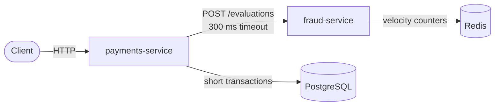

# payments-ledger

A double-entry payments ledger with a rule-based fraud service, built in Java 21.

Two services work together: `payments-service` moves money safely under concurrency and retries, and `fraud-service` evaluates every transfer with rules written in a small domain-specific language I designed and implemented.

```text
RULE high_value_foreign
WHEN amount > 100000 AND source.country != target.country
THEN REVIEW

RULE rapid_fire
WHEN velocity(1m) >= 5
THEN BLOCK
```

## Highlights

- **Double-entry ledger.** Every movement writes a debit and a credit of the same amount. Ledger entries are append-only, and an automated reconciliation proves balances match the ledger after every API test.
- **Safe under concurrency.** Accounts are locked in a fixed order with `SELECT ... FOR UPDATE`. A randomized test runs 2,000 concurrent transfers per seed and checks invariants such as "no money is created or lost".
- **Idempotent API.** Retried requests never charge twice. Responses are stored in the same transaction as the money movement, and stale keys are recovered safely with fencing tokens.
- **Fraud rules as a language.** A hand-written lexer, recursive-descent parser, semantic checker and evaluator. The service refuses to start if the rules contain errors, and reports the line and column.
- **Fails safe.** If the fraud service is slow or down, transfers go to manual review instead of being approved blindly.
- **Decisions backed by measurements.** Pessimistic and optimistic locking were both implemented and benchmarked before choosing.

## Architecture



A transfer goes through these steps:

1. Reserve the idempotency key.
2. Validate the request and read both accounts.
3. Call the fraud service, **outside any database transaction**.
4. Open a transaction, lock both accounts in order, check the balance and write the result.

| Fraud decision | Transfer status | HTTP |
| --- | --- | --- |
| `APPROVE` | `COMPLETED`, or `REJECTED` if funds are insufficient | 201 / 422 |
| `REVIEW` | `IN_REVIEW`, no money moves | 202 |
| `BLOCK` | `REJECTED` (`FRAUD_BLOCKED`) | 422 |
| Timeout, error or 5xx | `IN_REVIEW` (`FRAUD_UNAVAILABLE`) | 202 |

Transfers in review are approved or rejected through `POST /transfers/{id}/review`. Approval re-checks the balance, and concurrent approvals only move money once.

## Tech stack

| Area | Technology |
| --- | --- |
| Language | Java 21 (records, sealed interfaces, pattern matching) |
| HTTP | SparkJava |
| Database | PostgreSQL 16, Flyway, jOOQ with generated code, HikariCP |
| Cache | Redis 7 with Jedis |
| Tests | Spock, Testcontainers |
| Build and CI | Gradle multi-module, GitHub Actions |

## Running locally

**Requirements:** Java 21 and Docker.

```bash
cp .env.example .env
docker compose up -d --wait
```

Start each service in its own terminal:

```bash
./gradlew :fraud-service:run
./gradlew :payments-service:run
```

`payments-service` applies database migrations on startup and listens on port 8080. `fraud-service` loads `fraud-service/rules/default.rules` and listens on port 8081.

### Configuration

| Service | Variable | Default |
| --- | --- | --- |
| payments-service | `PORT` | `8080` |
| payments-service | `DATABASE_URL` | `jdbc:postgresql://localhost:5432/ledger` |
| payments-service | `DATABASE_USER` / `DATABASE_PASSWORD` | `ledger` / `ledger` |
| payments-service | `FRAUD_URL` | `http://localhost:8081` |
| fraud-service | `PORT` | `8081` |
| fraud-service | `RULES_PATH` | `rules/default.rules` |
| fraud-service | `REDIS_HOST` / `REDIS_PORT` | `localhost` / `6379` |

### Try it

```bash
ANA=$(curl -s -X POST localhost:8080/accounts -H 'Content-Type: application/json' \
  -d '{"ownerName":"Ana","currency":"EUR","country":"PT"}' | jq -r .id)
BRUNO=$(curl -s -X POST localhost:8080/accounts -H 'Content-Type: application/json' \
  -d '{"ownerName":"Bruno","currency":"EUR","country":"ES"}' | jq -r .id)

curl -s -X POST localhost:8080/deposits -H 'Content-Type: application/json' \
  -H "Idempotency-Key: $(uuidgen)" \
  -d "{\"accountId\":\"$ANA\",\"amountMinor\":500000}" | jq

# 2,000 EUR to another country: goes to review
curl -s -X POST localhost:8080/transfers -H 'Content-Type: application/json' \
  -H "Idempotency-Key: $(uuidgen)" \
  -d "{\"sourceAccountId\":\"$ANA\",\"targetAccountId\":\"$BRUNO\",\"amountMinor\":200000,\"currency\":\"EUR\"}" | jq
```

All amounts are integers in euro cents.

## API

### payments-service

| Method | Path | Description |
| --- | --- | --- |
| `GET` | `/health` | Health check |
| `POST` | `/accounts` | Create an account |
| `GET` | `/accounts/{id}` | Account with its balance |
| `GET` | `/accounts/{id}/entries?limit=&cursor=` | Statement, paginated by cursor |
| `POST` | `/deposits` | Deposit money. Requires `Idempotency-Key` |
| `POST` | `/transfers` | Transfer between accounts. Requires `Idempotency-Key` |
| `GET` | `/transfers/{id}` | Read a transfer |
| `POST` | `/transfers/{id}/review` | Approve or reject a transfer in review |

Errors are returned as JSON: `{"code": "...", "message": "..."}`.

### fraud-service

| Method | Path | Description |
| --- | --- | --- |
| `GET` | `/health` | Health check |
| `POST` | `/evaluations` | Returns `{"decision": "...", "matchedRules": [...]}` |

## The fraud rule language

The `fraud-dsl` module has no external dependencies. It is a classic compiler pipeline:

| Stage | Responsibility |
| --- | --- |
| `Lexer` | Turns text into tokens with line and column |
| `Parser` | Recursive descent. Builds an AST of sealed interfaces, with `AND` binding tighter than `OR` |
| `Checker` | Reports unknown fields, type mismatches, invalid operators, duplicate rules and invalid windows, without cascading errors |
| `Evaluator` | Runs the rules and returns the most severe decision. Short-circuits and memoizes `velocity(...)` lookups |

```text
ruleset    = { rule } EOF ;
rule       = "RULE" IDENT "WHEN" expr "THEN" ( "REVIEW" | "BLOCK" ) ;
expr       = andExpr { "OR" andExpr } ;
andExpr    = notExpr { "AND" notExpr } ;
notExpr    = "NOT" notExpr | primary ;
primary    = "(" expr ")" | comparison ;
comparison = operand ( ">" | ">=" | "<" | "<=" | "==" | "!=" ) operand ;
operand    = field | "velocity" "(" DURATION ")" | NUMBER | STRING ;
```

Available fields: `amount`, `source.ageDays`, `source.country` and `target.country`. `velocity(window)` counts the source account's transfers in a sliding window of up to 1 hour, stored in a Redis sorted set.

## Key design decisions

| Decision | Why |
| --- | --- |
| Amounts in `long` cents | Exact arithmetic, with overflow detection via `Math.addExact` |
| Database constraints as a second line of defence | A `CHECK` keeps balances non-negative even if the application has a bug |
| Pessimistic locking in a fixed order | Measured to be faster and error-free under contention. Fixed order prevents deadlocks |
| Fraud call outside the transaction | Slow network calls never hold connections or row locks |
| Idempotent response stored in the same transaction | There is never money moved without a stored response, or the opposite |
| Fencing tokens on idempotency keys | A slow original request cannot complete after another request took over its key |
| Cursor pagination | Constant cost on any page, unlike `OFFSET` |
| Generated jOOQ code committed to Git | CI compiles without a database |

Detailed reasoning is recorded as Architecture Decision Records (in Portuguese):

- [001: Locking strategy](docs/decisions/001-locking.md)
- [002: Idempotency](docs/decisions/002-idempotency.md)
- [003: Manual review](docs/decisions/003-manual-review.md)

## Results

**Concurrent transfers before and after locking.** 200 simultaneous transfers of 1 cent from an account with 100 cents:

| Version | Responses |
| --- | --- |
| Check balance, then write | 100 × 201, 82 × 500, 18 × 422 |
| Lock accounts first | 100 × 201, 100 × 422 (stable over 10 runs) |

**Locking strategy benchmark.** 1,000 transfers, 50 in parallel, median of 3 runs on a Ryzen 7 5800H with Docker Desktop on WSL:

| Scenario | Pessimistic | Optimistic |
| --- | --- | --- |
| One heavily contended account | 3,718 ms, no errors | 5,868 ms, 15–19 requests failed after retries |
| Independent accounts | 834 ms | 786 ms (within noise) |

The optimistic version lives in the `experiment/optimistic-locking` branch.

## Testing

```bash
./gradlew build
```

Tests run against real PostgreSQL and Redis instances through Testcontainers, so locks, constraints and transactions behave as in production. They cover:

- Every API endpoint, including validation and error responses
- Atomicity, by forcing a failure halfway through a transaction
- Race conditions and deadlocks, with concurrent requests
- Idempotency, including concurrent retries and stale key recovery
- A randomized traffic test with fixed seeds and invariant checks
- The full fraud DSL pipeline, and the fraud service with a fake HTTP server for timeouts and failures
- Ledger reconciliation after every API test

The contention benchmark is skipped by default:

```bash
BENCHMARK=1 ./gradlew :payments-service:test --tests '*ContentionBenchmarkSpec'
```

## Project structure

```text
payments-ledger/
├── payments-service/   Ledger API: accounts, deposits, transfers, idempotency, review
├── fraud-service/      Fraud evaluation API and Redis velocity store
├── fraud-dsl/          Rule language: lexer, parser, checker, evaluator
├── docs/decisions/     Architecture Decision Records
└── docker-compose.yml  Local PostgreSQL and Redis
```

## Scope

This is a portfolio project, not a production system. Notable things left out on purpose:

- Authentication and authorization, including who may review transfers
- Multiple currencies
- Cleanup of old idempotency keys
- A deadline for transfers left in review